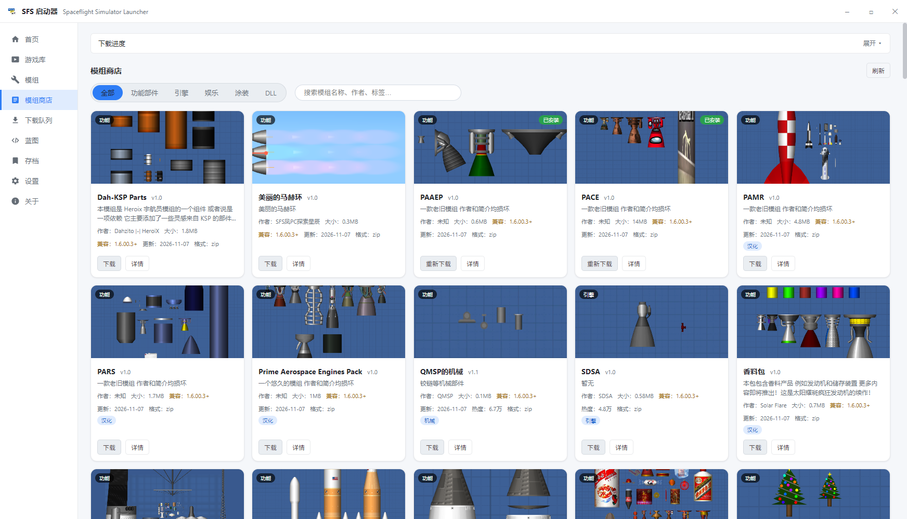
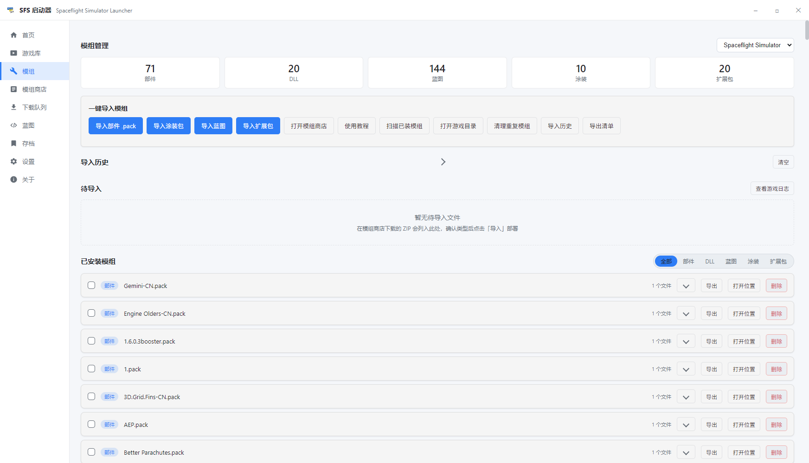
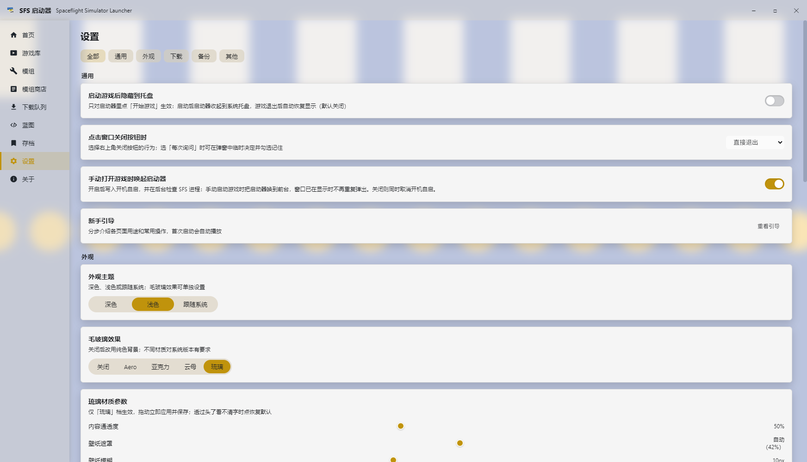

# SFS Launcher

A Windows launcher for Spaceflight Simulator. Instances, mods, blueprints, saves and appearance in one window.

Current version **0.88.2**, Windows 10 / 11 (x64). The game is not bundled — you need your own copy.

Website and downloads: https://miaolan66.github.io/sfslauncher/

[中文说明](README.md)

## Features

### Instances
- Scan the Steam library for the game, or point it at a folder manually
- Keep several game versions side by side; switching instances does not touch the others
- Pre-flight check before launch, missing files are reported up front
- Crash dialog lists the log paths and opens a filtered log in one click
- Last launch time is recorded and instance cards sort by it

### Mods
- Imports parts, texture packs, blueprints, DLLs and expansion packs
- Imports land in a pending queue first, so a half-finished install cannot leave the game broken
- Search and type filters on the installed list; virtual scrolling keeps long lists responsive
- Detects mod version updates; exports a mod list for backup or sharing
- Opens the mod data folder for manual inspection

### Mod store
- Browse and filter mods inside the launcher, no browser hop
- Selected mods go to the download queue with pause, cancel and retry
- Finished downloads move straight into the pending queue

### Blueprints and saves
- Blueprints are scanned by directory and shown as a tree, neither flattened nor nested to death
- Read blueprint contents, reveal the containing folder, or remove the file
- One-click save backup with restore and delete; the target folder can be chosen at backup time

### Appearance
- Dark / light / follow system, with two separately tuned palettes
- Custom wallpaper, stored either compressed or as the original file
- Accent color derived from the wallpaper, or locked manually
- Five glass modes: off, Aero, acrylic, mica, Liuli. Available options depend on OS build and hardware
- The Liuli mode exposes four material sliders — content opacity, wallpaper veil, wallpaper blur, glow — applied live while dragging

### Language
- Chinese/English UI, switch in the bottom-left corner; the choice is written to the config and restored on the next launch
- Static pages and runtime-generated lists, empty states, toasts and dialogs all go through the same dictionary

### System integration
- Launch at login, hide to tray after launch, configurable close-button behavior
- Proxy and download directory settings
- WebDAV backup
- An eight-step spotlight tour on first run, replayable at any time
- One-click Chinese translation injection (see acknowledgements)

## Screenshots

| Mod store | Mod management |
| --- | --- |
|  |  |



## Download

Get the latest build from [Releases](../../releases). Two packages:

| Package | Description |
| --- | --- |
| `SFSLauncher-<version>-x64-setup.exe` | Installer, installs per user, lets you pick the target folder, creates desktop and Start menu shortcuts |
| `SFSLauncher-<version>-x64-portable.exe` | Portable, no installation, runs wherever you put it |

Both packages are feature-identical and install the Chinese pack inside the launcher.

## Running from source

The source archive is at the repository root: `SFSLauncher-0.88.2-source.zip`.

Requires Node.js 18 or newer and npm.

```bash
npm install
npm start          # run directly
npm run dist       # build, output in dist/ (NSIS installer + portable)
```

If a build from `dist/win-unpacked` is still running, close it before packaging — locked files make the build fail.

## Implementation

- **Electron 33.** The main process handles files, processes, windows and system calls. The renderer is plain HTML / CSS / JS with no framework and no build step — edit and reload.
- **Glass** goes through koffi straight into Win32 / DWM: native blur on Win10, mica or acrylic on Win11. When the material is unavailable it falls back to a solid background instead of pretending.
- **Liuli material** derives its color, veil and shadow logic from qqnt-liuli-theme. The palette is exposed as `--ll-*` variables and mapped onto the existing styles.
- **Icons and file properties** are written with rcedit so the installer and taskbar icons stay consistent.
- **Packaging** uses electron-builder, producing an NSIS installer and a single-file portable build.

## Layout

```
main.js            Main process: windows, instances, mods, downloads, backups, system integration
preload.js         Bridge between renderer and main process
dwm-glass.js       DWM glass calls
glass-config.js    Material configuration and fallback rules
win-proc.js        Process detection and game launch
win-reg.js         Registry (launch at login)
webdav.js          WebDAV backup
fileTasks.js       File tasks (import, extract, deploy)
fs-worker.js       File scanning worker
renderer/          UI: pages, styles, Liuli theme, onboarding
  liuli-theme.js   Liuli material controller
  app-theme.js     Theme and material switching
  mcu.js           M3 role color computation
assets/bin/        Translation injector (kept, no longer the default path)
assets/han/        Runtime, font and word list (installed by the launcher)
build/             Installer icons and bitmap assets
scripts/           Packaging hooks
```

## Acknowledgements

- **a future star**: technical support
- **Arctic.**: technical support; the translation runtime and word list come from `SFSChineseInjector`, used under that repository's license
- **qqnt-liuli-theme**: the color and veil implementation of the Liuli material is based on this project

## License

GPL-3.0-or-later (GPL-3.0 or any later version); see [LICENSE](LICENSE) for the full text. Any distribution of this software or a modified version must include the complete corresponding source under the same license.

`assets/bin/SFSChineseInjector.exe` and the runtime, font and word list under `assets/han/` come from [Arctic-Ice67/SFSChineseInjector](https://github.com/Arctic-Ice67/SFSChineseInjector). That repository's `LICENSE` is the **PolyForm Strict License 1.0.0** (noncommercial use only; redistribution, modification and derivative works are not permitted by default), not MIT. This repository's GPL-3.0-or-later does not cover or relicense those files. Before shipping them in an installer, obtain the author's written permission covering distribution, modification and derivative works; if such permission already exists, that permission governs. Without it, use these files locally only and do not publish `assets/han/` or `assets/bin/` with a release.

This is an unofficial tool, not affiliated with the developers of Spaceflight Simulator. Saves, mods and blueprints used with this tool are at your own risk — back up anything important.
