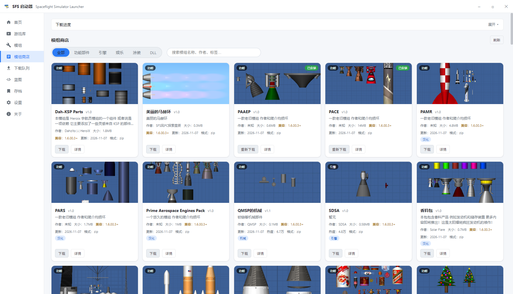
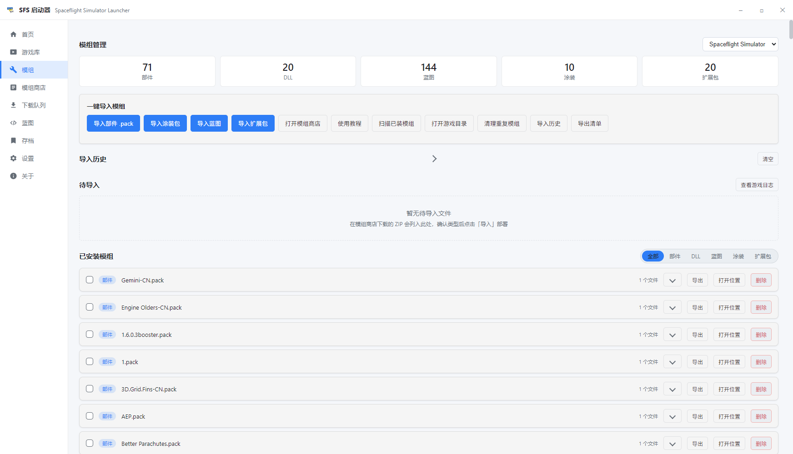
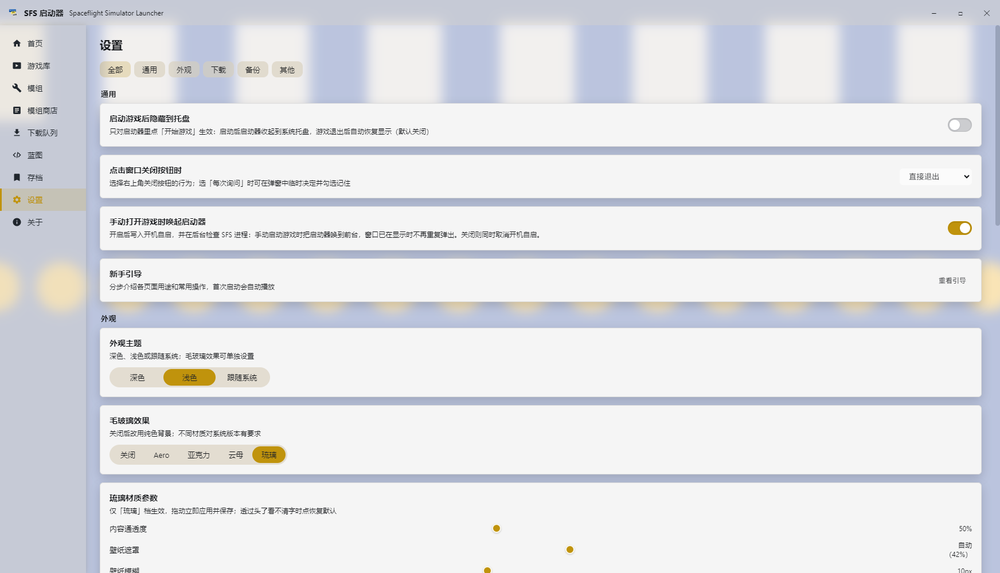

# SFS 启动器

Spaceflight Simulator 的 Windows 启动器：实例、模组、蓝图、存档、外观收进一个窗口。

当前版本 **0.88.0**，支持 Windows 10 / 11（x64）。游戏本体需要自行准备，这个工具不包含游戏文件。

## 功能

### 实例
- 从 Steam 库扫描游戏，也可以手动指定目录
- 多版本实例分开存放，切换实例不影响其它版本
- 启动前做预检查，缺文件会直接提示
- 游戏崩溃时弹窗，把日志路径列出来，可一键打开过滤后的日志
- 记录最近启动时间，实例卡片上按时间排序

### 模组
- 支持部件、涂装包、蓝图、DLL、扩展包五类导入
- 导入先进待安装队列，确认后再部署，避免装一半
- 已装列表支持搜索与类型筛选，长列表用虚拟滚动保持流畅
- 检测模组版本更新，可导出模组清单做备份或分享
- 打开模组数据目录，方便手工排查

### 模组商店
- 在启动器里浏览和筛选模组，不跳浏览器
- 选中的模组进下载队列，可暂停、取消、重试
- 下载完成后直接进待安装队列

### 蓝图与存档
- 蓝图按目录扫描，树形展开，不拍平也不多层嵌套
- 蓝图文件可读取内容、打开所在目录、移除
- 存档一键备份，支持还原与删除，备份前可单独选择目标目录

### 外观
- 深色 / 浅色 / 跟随系统，两套配色独立调校
- 自定义壁纸，入库时可选压缩或原图复制
- 强调色按壁纸自动派生，也能手动锁定
- 毛玻璃五档：关闭、Aero、亚克力、云母、琉璃，按系统版本和硬件性能给出可用项
- 琉璃档带四个材质滑块：内容通透度、壁纸遮罩、壁纸模糊、泛光，拖动实时生效

### 系统集成
- 开机自启、启动后隐藏到托盘、关闭按钮行为可选
- 代理设置、下载目录设置
- WebDAV 备份
- 首次启动有八步聚光引导，可随时重看
- 一键注入中文（见下方致谢）

## 截图

| 模组商店 | 模组管理 |
| --- | --- |
|  |  |



## 下载

到 [Releases](../../releases) 页取最新版本，两种包：

| 包 | 说明 |
| --- | --- |
| `SFS 启动器-<版本>-x64-setup.exe` | 安装版，按当前用户安装，可改安装目录，建桌面和开始菜单快捷方式 |
| `SFS 启动器-<版本>-x64-portable.exe` | 便携版，免安装，放在哪就在哪运行 |

安装版和便携版功能一致，都自带汉化注入器。

## 从源码运行

需要 Node.js 18 以上、npm。

```bash
npm install
npm start          # 直接运行
npm run dist       # 打包，产物在 dist/（NSIS 安装包 + 便携版）
```

打包前如果 `dist/win-unpacked` 里的程序正在运行，先关掉，否则文件被占用会失败。

## 技术实现

- **Electron 33**，主进程负责文件、进程、窗口和系统调用，渲染层是纯 HTML / CSS / JS，没有前端框架和构建步骤，改完刷新就生效
- **毛玻璃**走 koffi 直接调 Win32 / DWM：Win10 用原生模糊，Win11 用云母或亚克力；探测不到就回退实色，不硬撑
- **琉璃材质**的取色、遮罩、阴影逻辑参考 qqnt-liuli-theme 的实现，色板挂成 `--ll-*` 变量再映射到现有样式
- **图标与文件属性**用 rcedit 写入，避免安装包和任务栏图标不一致
- **打包**用 electron-builder，输出 NSIS 安装包和 portable 单文件

## 目录

```
main.js            主进程入口：窗口、实例、模组、下载、备份、系统集成
preload.js         渲染层与主进程的桥
dwm-glass.js       DWM 毛玻璃调用
glass-config.js    材质配置与回退规则
win-proc.js        进程检测与游戏启动
win-reg.js         注册表（开机自启）
webdav.js          WebDAV 备份
fileTasks.js       文件任务（导入、解压、部署）
fs-worker.js       文件扫描工作线程
renderer/          界面：页面、样式、琉璃主题、引导
  liuli-theme.js   琉璃材质控制器
  app-theme.js     主题与材质切换
  mcu.js           M3 角色色计算
assets/bin/        汉化注入器
build/             安装包图标与位图资源
scripts/           打包钩子
```

## 致谢

- **a future star**：技术支持
- **Arctic.**：技术支持；汉化注入器 `SFSChineseInjector` 由其开发（已获作者授权集成）
- **qqnt-liuli-theme**：琉璃材质的取色与遮罩实现参考了该项目

## 许可

MIT，见 [LICENSE](LICENSE)。

这是非官方工具，与 Spaceflight Simulator 的开发方没有关系。使用本工具产生的存档、模组和蓝图风险由使用者自行承担，重要存档建议先备份。
